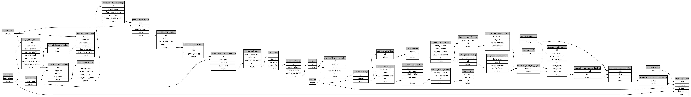

```
# AUTOGENERATED BY ECOSCOPE-WORKFLOWS; see fingerprint in README.md for details

```

```yaml
# fingerprint:
artifacts_sha256_basic: c81f19acc576d82b6f485153a2a804d39da92c325d9869963e2e2a33a0976218
artifacts_sha256_strict: 67dc839c35158ce20f8e298968a75a9d3b2aa9dc6dcfd87373f406eb01e85ff8
installed_requirements:
- channel: https://repo.prefix.dev/ecoscope-workflows/
  name: ecoscope-platform
  version: {version: ==2.31.0}
- channel: conda-forge
  name: pydeck
  version: {version: ==0.9.2}
params_sha256: 2f3c6b6ff636d4c60905e0dc2bf421a3b764b4cc6883f7ec4a8372885fa1b808
spec_sha256: 05a53e7acd687be7f402fff23ebf0fddaee05b1a4b8ead675523550848543c8f

```

# ecoscope-workflows-download-events-workflow



